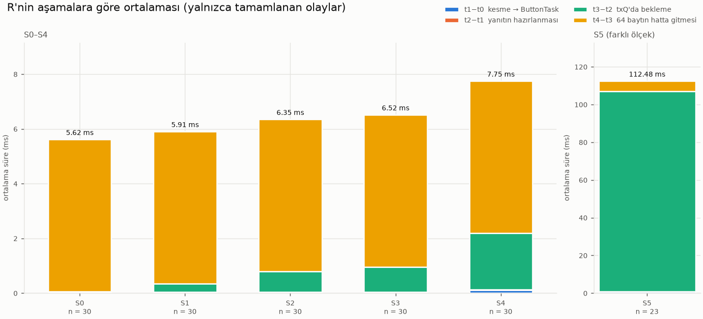
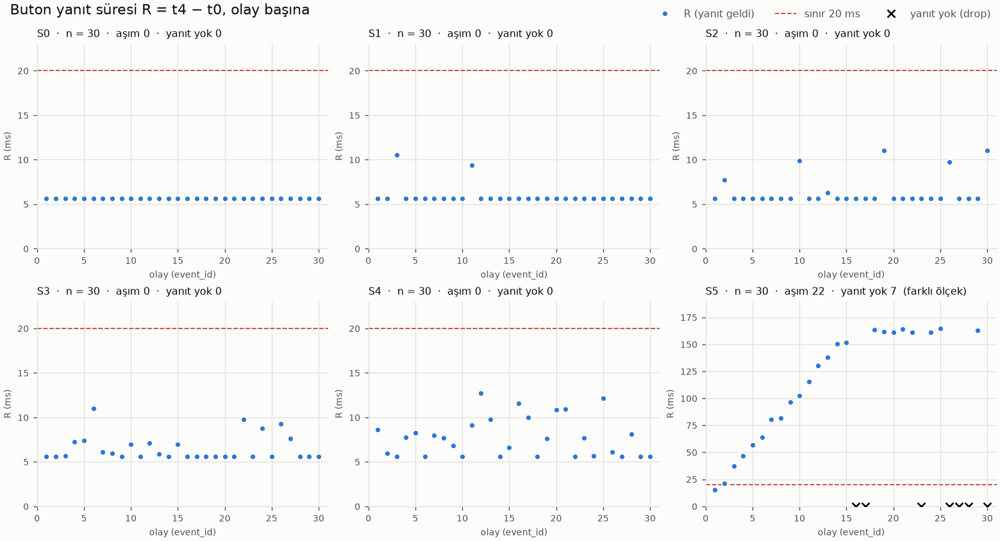

# Hafta 1 raporu: Yük altında buton yanıt süresi

STM32F407 Discovery + FreeRTOS. Ölçümler: 2026-10-22, her senaryoda 30 basış.
Ham veri: `measurements/S0..S5.csv`; özet: `measurements/summary.csv`;
grafikler: `analysis/plots/`. Tüm sayılar bu dosyalardan alınmıştır.

## 1. Özet

Butona basıldığı andan (t0) yanıt mesajının son bitinin UART'tan çıktığı ana
(t4) kadar geçen süreyi, R'yi, altı yük senaryosunda ölçtüm.

- **Yüksüz (S0):** R her basışta 5,61–5,62 ms. Bunun %99'u 64 baytın hatta
  gitme süresi.
- **S1–S4:** Yük arttıkça gözlenen maksimum R 10,5 ms'den 12,7 ms'ye çıktı.
  30 yanıtın hiçbiri 20 ms'yi aşmadı; drop ve timeout yok. Artış S1–S3'te
  yalnızca t3−t2'de (yanıtın gönderim kuyruğunda beklemesi), S4'te ek olarak
  t1−t0'da görüldü.
- **S5'te sistem aşırı yüklendi:**
  - Yanıtı gelen 23 basışın 22'si 20 ms'yi aştı; gözlenen maksimum 164,7 ms.
  - 7 basışın yanıtı hiç gönderilemedi (`tx_drop`).
  - Neden: CPU işi, en düşük öncelikli gönderim görevinin yeni mesaj
    başlatmasını geciktirdi. UART kapasitesi telemetrinin ürettiği mesaj
    sayısına düştü ve her yanıt kuyrukta kalıcı bir birikim bıraktı.
  - Video sırasında yapılan tekrar koşusu aynı davranışı gösterdi.

## 2. Sistem

**Donanım ve yazılım:**
- Donanım: STM32F407VG (HCLK 168 MHz), USART2 (PA2, 115200 8N1, TX DMA:
  DMA1 Stream6), USB-TTL dönüştürücü (CP2102) ile PC.
- Yazılım: FreeRTOS V11.3.1 (preemptive, 1 kHz tick, kendi API'si), STM32 HAL
  v1.8.5. CubeMX kullanılmadı; yapılandırma elle yazıldı. Ayrıntılar:
  `docs/setup.md`.

```
Buton kesmesi (t0) --buttonQ(8)--> ButtonTask p2 (t1, t2) --txQ(16)--> UartTxTask p1 (t3) --DMA--> USART2
                                   TelemetryTask p3 (TEL) --txQ--^       TC kesmesi (t4)
```

- **Görevler ve öncelikler:** TelemetryTask 3 (yük), ButtonTask 2 (incelenen),
  UartTxTask 1 (UART'a dokunan tek görev). Kesmeler (EXTI0, USART2, DMA) NVIC
  önceliği 6; `FromISR` API'si için gereken ≥ 5 şartını sağlıyor.
- **Kuyruklar:** FIFO; öğeler değer olarak kopyalanır. `buttonQ` 8 olay,
  `txQ` 16 mesaj. BTN yanıtları ve TEL mesajları aynı `txQ`'da sıraya girer.
- **Mesajlar:** Her TEL/BTN satırı tam 64 bayt (metin + boşluk + LF).
  115 385 baud'da (42 MHz'den bölünen gerçek değer) hat süresi
  64 × 10 bit ≈ 5,55 ms.

**Ölçüm noktaları** (zaman kaynağı TIM2: 32-bit, 1 µs, kesmesiz):

| Nokta | Nerede | Aralık | Neyi ölçer |
|---|---|---|---|
| t0 | Buton kesmesinin ilk satırı | t1−t0 | Kesmeden ButtonTask'in çalışmasına |
| t1 | ButtonTask, olay alınınca | t2−t1 | Yanıtın hazırlanması |
| t2 | `txQ`'ya vermeden önce | t3−t2 | Kuyrukta bekleme + UartTxTask'in CPU alması |
| t3 | DMA başlatmadan önce | t4−t3 | 64 baytın hatta gitmesi |
| t4 | UART TC (son bit) kesmesi | R = t4−t0 | Toplam; sınır ≤ 20 ms |

t4'ün DMA bitişinde değil, son stop biti çıktıktan sonra gelen TC kesmesinde
alındığı HAL kaynağında doğrulandı (`docs/code-notes.md`, bölüm 4). Farklar
işaretsiz 32-bit alınır; eksik zaman boş bırakılır, 0 yazılmaz. Ölçüm
sırasında hiçbir şey yazdırılmaz; kayıtlar 64 olaylık RAM havuzunda birikir ve
deney sonunda gönderilir.

## 3. Yöntem

| Senaryo | Telemetri | CPU işi | UART'ın TEL ile meşgul payı | CPU iş payı |
|---|---|---|---|---|
| S0 | kapalı | — | %0 | %0 |
| S1 | 10 Hz | — | ~%6 | ~%0 |
| S2 | 50 Hz | — | ~%28 | ~%0 |
| S3 | 100 Hz | — | ~%56 | ~%0 |
| S4 | 100 Hz | ~2 ms | ~%56 | ~%20 |
| S5 | 100 Hz | ~5 ms | ~%56 | ~%50 |

**CPU işi:** Sonucu `volatile` değişkene yazılan ve optimizasyonla
silinemeyen sabit iterasyonlu bir döngü; kesmeler açık.
- Açılışta 100 000 iterasyon 8 kez ölçüldü; en kısa tur (12 537 µs)
  kullanılarak 7976 iterasyon/ms bulundu.
- S4 için 15 952, S5 için 39 880 iterasyon.
- Deney sırasında ölçülen ortalama iş süresi: S4'te 2002 µs, S5'te 5011 µs.
  Bu süre kesme sürelerini de içerir.
- Kalibrasyon yalnızca kullanılan Debug (-O0) derleme için geçerlidir.

**Prosedür:**
- Her senaryo ayrı derlendi ve debugger bağlı değilken çalıştırıldı.
- Kart resetlendi; açılıştan sonraki 5 s ısınma süresinde basışlar
  kaydedilmedi.
- 30 basış elle yapıldı: aralar ≥ 0,5 s, düzensiz ritim. Ritim, basışlar
  telemetri periyoduyla senkron olmasın diye düzensiz tutuldu.
- 30. kabulden sonra kart kendiliğinden durdu. Son olaydan 1 s sonra telemetri
  durduruldu ve kayıtlar gönderildi. PC arayüzü (`interface/`) satırları
  okuyup CSV'ye kaydetti.

**Kontroller:** Her koşuda senaryo etiketi, TEL periyodu, iş süresi ve
64 bayt kontrolü doğrulandı. 64 bayt olmayan satır 0, çözülemeyen satır 0
(`measurements/olcum_defteri.md`).

## 4. Sonuçlar

### R özeti (n = 30 basış / senaryo)

| Senaryo | Yanıt gelen | R min (ms) | R ort (ms) | R p95 (ms) | Gözlenen R maks (ms) | > 20 ms | Yanıt yok |
|---|---|---|---|---|---|---|---|
| S0 | 30 | 5,612 | 5,617 | 5,622 | 5,622 | 0 | 0 |
| S1 | 30 | 5,612 | 5,906 | 9,364 | 10,533 | 0 | 0 |
| S2 | 30 | 5,612 | 6,351 | 11,018 | 11,043 | 0 | 0 |
| S3 | 30 | 5,614 | 6,518 | 9,737 | 10,980 | 0 | 0 |
| S4 | 30 | 5,613 | 7,750 | 12,148 | 12,749 | 0 | 0 |
| S5 | 23 | 15,329 | 112,477 | 163,915 | 164,743 | 22 | 7 (`tx_drop`) |

p95 en yakın sıra yöntemiyle hesaplandı. n = 30'da tek bir olaya dayanır.

### Aşama ortalamaları (ms, yalnızca beş zamanı da olan olaylar)

| Senaryo | n | t1−t0 | t2−t1 | t3−t2 | t4−t3 | Toplam = ort. R |
|---|---|---|---|---|---|---|
| S0 | 30 | 0,014 | 0,019 | 0,029 | 5,556 | 5,617 |
| S1 | 30 | 0,014 | 0,019 | 0,317 | 5,556 | 5,906 |
| S2 | 30 | 0,014 | 0,019 | 0,762 | 5,557 | 6,351 |
| S3 | 30 | 0,013 | 0,019 | 0,929 | 5,556 | 6,518 |
| S4 | 30 | 0,111 | 0,018 | 2,064 | 5,556 | 7,750 |
| S5 | 23 | 0,962 | 0,019 | 105,940 | 5,556 | 112,477 |





Kartın sayaçlarından:
- `txQ`'nun gözlenen en dolu hali S0–S3'te 1, S4'te 2, S5'te **16** (kuyruk
  tamamen dolu).
- Düşen telemetri (`tel_drop`) yalnızca S5'te var: 9.
- Telemetri periyodu tüm senaryolarda ortalama tam 10 000 / 20 000 /
  100 000 µs. En büyük sapma ±11 µs (S4/S5).

## 5. Tartışma

### S0: taban çizgisi

R = 5,617 ms'nin 5,556 ms'si (%98,9) t4−t3, yani mesajın hatta gitme süresi.
Yazılım zinciri (t0→t3) yalnızca ~62 µs.

t4−t3 tüm senaryolarda 5,55–5,56 ms'de sabit kaldı. Bu bir kontrol ölçümü:
mesaj boyu ve baud değişmediği için değişmemesi gerekiyordu.

### S1–S3: UART yükü

- **Artış yalnızca t3−t2'de.** Ortalama 0,03 → 0,32 → 0,76 → 0,93 ms.
- **t1−t0 değişmedi** (0,013–0,014 ms). Telemetri CPU'yu neredeyse hiç
  kullanmıyor.
- **Neden:** Basış, o an gönderilmekte olan bir TEL mesajına denk gelirse
  yanıt onun bitmesini bekliyor.

Bekleyen basış sayısı (t3−t2 > 0,1 ms) hattın meşgul olma payıyla uyumlu:

| Senaryo | Bekleyen basış | Hattın meşgul payından beklenen |
|---|---|---|
| S1 | 2 / 30 | ~1,7 |
| S2 | 6 / 30 | ~8,3 |
| S3 | 13 / 30 | ~16,7 |

Bekleme en fazla bir mesaj süresi kadar (gözlenen en büyük 5,45 ms).

Gözlenen maksimum R üç senaryoda da ~10,5–11,0 ms'de kaldı, çünkü üst sınırı
"bir mesajın kalanı + kendi mesajı + yazılım zinciri" ≈ 5,56 + 5,56 + 0,06 ≈
11,2 ms belirliyor. Yük arttıkça
artan şey maksimum değil, beklemenin **sıklığı**. Bu yüzden ortalama R
yükseldi.

### S4: CPU yükü eklenince

- **t1−t0 da büyüdü:** gözlenen maksimum 1,58 ms; 3 basışta > 0,1 ms. Basış
  TelemetryTask'in (öncelik 3) 2 ms'lik işi sırasında gelirse ButtonTask
  (öncelik 2) onun bitmesini bekliyor.
- **t3−t2 ortalaması 2,06 ms'ye çıktı** (S3'te 0,93). Bekleyen basış 20 / 30.
  CPU işi, UartTxTask'in bir sonraki gönderimi başlatmasını da geciktiriyor.
- **Sonuç:** Gözlenen maksimum R 12,7 ms; 20 ms'nin altında, kayıp yok.
  Kuyruk en fazla 2 mesaja çıktı.

### S5: aşırı yük

Her 10 ms'lik periyodun 5 ms'si CPU işi. Bu sürede UartTxTask (öncelik 1)
çalışamaz; DMA'ya yeni gönderim veremez. Bir mesaj 5,56 ms sürdüğü için kalan
5 ms'lik boşlukta bitemiyor ve sonraki mesaj ancak bir sonraki iş bitince
başlıyor:

```
ms     0    5    10   15   20   25   30
CPU    #####.....#####.....#####.....        # = CPU işi
UART   .....======....======....======       = = mesaj hatta
```

Bu yüzden periyot başına **en fazla bir** mesaj gidebiliyor; telemetri de
periyot başına tam bir mesaj üretiyor. Hatta boş kapasite kalmıyor. Her BTN
yanıtı bir yeri alıyor ve geride kalan TEL bir daha yetişemiyor. Kısaca:
**CPU işi + mesaj süresi (5 + 5,56 ms) periyodu (10 ms) aşıyor.** S4'te
2 + 5,56 < 10 olduğu için bu olmadı.

Veri bunu adım adım gösteriyor:
- t3−t2 basışlar arası süreden (0,6–6,2 s) bağımsız olarak her basışta
  ~10 ms arttı: 9,7 → 15,5 → 30,0 → 40,0 → 50,0 … ms.
- 15. basıştan sonra kuyruk doldu (16). Sonraki basışların yanıtları ya
  ~160 ms bekledi ya da kuyruğa giremeyip düştü: 30 basışta 7 `tx_drop`.
- Telemetri de kuyruk dolu olduğu için 9 mesaj kaybetti.
- t1−t0 da büyüdü: 30 basışta gözlenen maksimum 5,0 ms; ButtonTask 5 ms'lik
  işi bekledi.
- PC arayüzünde de görüldü: Düşen yanıtlar hiç gelmediği için basış sayacı
  birkaç basış boyunca artmadı, sonra son olay numarası atladı (örneğin
  15'ten 18'e).

**Telemetri S5'te daha fazla mesaj üretmedi.** S3 ile S5 aynı sayıda TEL
üretiyor (100/s). Fark, gönderme kapasitesinin CPU yükü yüzünden düşmesi.

**Tekrarlanabilirlik:** 2026-10-23'te video sırasında yapılan ikinci S5 koşusu
aynı davranışı gösterdi (`measurements/S5_2.csv`; resmi ölçüm değil):
- aynı ~10 ms'lik merdiven,
- kuyruk 16'da doldu,
- 5 `tx_drop`, 11 `tel_drop`,
- yanıtı gelen 25 basışın 24'ü > 20 ms, gözlenen maksimum 165,1 ms.

### Hipotezler ve sonuçlar

| Ölçmeden önceki beklenti | Sonuç |
|---|---|
| S0: R ≈ 5,56 ms + küçük ek, t3−t2 çok küçük | Doğru: 5,62 ms; t3−t2 0,03 ms |
| S1→S3: ortalama ve maksimum R artar, artış t3−t2'de, t1−t0 değişmez | Ortalama ve t3−t2 için doğru. Maksimum R S0'a göre arttı (5,6 → ~11 ms) ama S1–S3 arasında ~11 ms'de sabit kaldı: üst sınırı bir mesaj süresi belirliyor, yükle artan beklemenin sıklığı |
| S4/S5: t1−t0 da artar | Doğru: maksimum 1,58 ms (S4) ve 5,0 ms (S5) |
| S5: en kötü durumda R ~20,6 ms, sınıra yakın | **Yanlış.** Gözlenen maksimum 164,7 ms ve 7 kayıp |

S5 tahmini kuyruğun boş olduğunu varsayıyordu ve her yanıtın kuyrukta kalıcı
birikim bırakacağını hesaba katmamıştı. Tahminin tutmamasının nedeni,
yukarıdaki kapasite hesabı ölçmeden önce yapılmış olsaydı görülebilirdi.

## 6. Ölçümün sınırları

- **"Gözlenen maksimum"**, 30 basışta görülen en büyük değerdir; en kötü
  durum garantisi değildir.
- **t0 fiziksel basış anı değildir;** kesmenin zamanlayıcıyı okuduğu andır.
  **t4 son bitin tam anı değildir;** TC kesmesinin işlendiği andır.
  Çözünürlük 1 µs'dir; bu 1 µs doğruluk anlamına gelmez.
- **Basışlar elle yapıldı.** Basışların telemetri periyoduna göre zamanlaması
  rastgele kabul edildi.
- **Bekleyen basış oranları 30 basışlık örnekten.** Hattın meşgul payıyla
  karşılaştırma kaba bir kontroldür.
- **S5'in aşama ortalamaları** yalnızca yanıtı gelen 23 olaydan; düşen 7 olayın
  t3 ve t4'ü yoktur.
- **CPU işi süresi kesmeleri de içerir.** Kalibrasyon -O0 derlemeye özgüdür.
- **Arayüzdeki ısınma geri sayımı PC saatine dayanır, yaklaşıktır.** Kartta
  ısınma FreeRTOS tick sayacıyla uygulanır.

## 7. Şartnameye yapılan ekler

1. **Bırakma şartı (tekrar-kenar filtresine ek).**
   - Şartname kuralı (ilk kenarı kabul et, sonraki 30 ms'deki kenarları at)
     aynen uygulandı.
   - Ek kural: kabul edilen basıştan sonra buton 30 ms kesintisiz bırakılmış
     görülmeden yeni basış kabul edilmez.
   - Gerekçe: Bu kartta bırakma zıplaması 30 ms'den sonra kenar üretip sahte
     basış sayılıyordu.
   - Ölçüm koşularında 274 kenarın 180'i kabul edildi. 30 ms kuralı hiçbir
     kenarı elemedi, bırakma şartı ise 94 kenarı eledi. Bu kural olmasaydı bu
     kenarlar sahte basış olarak kaydedilecekti.
2. **Deney akışı:** 5 s ısınma, 30. kabulde otomatik durma, son olaydan 1 s
   sonra dışa aktarma. Bekleme, durdurma işinin son olayın ölçümüne
   karışmaması ve son olayın da aynı yük altında ölçülmesi içindir.
3. **Dışa aktarma satırları (REC/CNT/END) 64 bayt kuralının dışındadır.**
   Ölçüm bittikten sonra gönderildikleri için hiçbir ölçülen aralıkla zamanda
   çakışmazlar.

## 8. İyileştirme önerileri (şartname dışı, uygulanmadı)

**Temel ilke:** Kuyruk *geçici* yığılmaları emer, *sürekli* aşırı yükü
ememez. Kuyruğu büyütmek S5'i düzeltmez; yalnızca kaybı erteler ve beklemeyi
uzatır (32 yerlik kuyrukta ~320 ms).

1. **Önce kapasite hesabı.** Her periyotta "CPU işi + gönderilecek mesajların
   süresi < periyot" olmalı, pay bırakılarak.
2. **Kritik trafiği ayırmak.** Yanıtın süre sınırı var, telemetrinin yok:
   - BTN için ayrı ya da öne alınan (`xQueueSendToFront`) bir kuyruk.
   - Telemetri için tek yerlik, üzerine yazılan (`xQueueOverwrite`) bir
     kuyruk; böylece telemetri birikmez, hep en günceli gider.
3. **Öncelikleri kritikliğe göre vermek.**
   - UartTxTask'in kendi işi kısadır (mesaj başına birkaç µs); yükseltilirse
     hat boşta kalmaz.
   - Bir sonraki gönderim doğrudan TC kesmesinden de başlatılabilir.
   - ButtonTask'i yükün üstüne almak t1−t0'daki bekleyişi kaldırır.
4. **Yükü azaltmak.** Daha yüksek baud (921 600'de 64 bayt ≈ 0,7 ms), daha
   kısa ya da daha seyrek telemetri.
5. **Aşırı yükte neyin feda edileceğine baştan karar vermek.** Örneğin
   telemetri, kuyruk belli bir doluluğun üstündeyse kendi mesajını atlar.

Bu öneriler ölçülmedi; etkileri hesaba dayalı tahminlerdir.

## 9. Sonuç

- **R'nin tabanı mesajın hatta gitme süresi:** ~5,6 ms.
- **UART yükü (S1–S3)** R'yi yalnızca t3−t2 aşamasında ve en fazla bir mesaj
  süresi kadar uzattı.
- **Ek CPU yükü (S4)** t1−t0'ı da büyüttü, ama 30 yanıtın hiçbiri 20 ms'yi
  aşmadı.
- **S5'te sınır aşıldı.** CPU yükü, düşük öncelikli gönderim görevinin
  kapasitesini telemetri üretimine eşitledi. Kuyruk doldu: 22 aşım, 7 kayıp,
  gözlenen maksimum 164,7 ms.

Ana ders: sabit öncelikli bir sistemde gecikmeyi yalnızca yükün büyüklüğü
değil, **kritik yolun hangi öncelikte çalıştığı** ve **kapasitenin talebi
karşılayıp karşılamadığı** belirliyor.

---

Kodun açıklaması: `docs/code-notes.md`. Kurulum ve yapılandırma:
`docs/setup.md`. Ölçüm koşulları: `measurements/olcum_defteri.md`. Yapay zekâ
kullanımı: `docs/ai-usage.md`.
